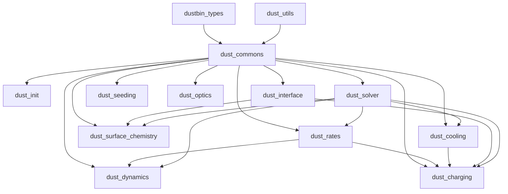

# CALIMA dust module layout

This folder contains the CALIMA dust and PAH physics used by RAMSES. The code is split into small modules so that shared state, table loading, physics kernels, and runtime wrappers stay separate.

## Module hierarchy



The practical layering is:

1. dustbin_types defines the derived types used everywhere else.
2. dust_utils provides generic interpolation and helper routines.
3. dust_commons holds the shared dust and PAH parameters, bin properties, counters, and global switches.
4. The physics modules build on that shared state: dust_rates, dust_charging, dust_surface_chemistry, dust_dynamics, dust_cooling, dust_optics, and dust_seeding.
5. dust_init performs startup validation and table loading.
6. dust_interface exposes the dust helper routines used by the RTZ cooling path.
7. dust_solver is the main time-integration driver for dust chemistry.

## File guide

| File | Purpose |
| --- | --- |
| dustbin_types.f90 | Defines the core derived types: DustTable, DustChemistryInfo, DustBin, and PAHBin. Also provides init/reset methods for the reusable dust chemistry workspace. |
| dust_utils.f90 | Generic helpers used throughout CALIMA, including search/interpolation routines, turbulence utilities, and small math helpers. |
| dust_commons.f90 | Central shared module for dust/PAH flags, namelist-controlled parameters, per-bin properties, global counters, and helper data used by the rest of CALIMA. |
| dust_rates.f90 | Computes the characteristic timescales for dust and PAH processes: accretion, sputtering, coagulation, shattering, RATD, sublimation, evaporation, freezing, and related update switches. |
| dust_charging.f90 | Implements dust charge distributions and mean charge estimates, plus Coulomb focusing helpers and charge-state mixing routines. |
| dust_surface_chemistry.f90 | Handles H2 formation on dust grains, sticking and recombination efficiencies, and related surface chemistry fits. |
| dust_dynamics.f90 | Provides grain relative velocities and dust destruction in shocks, including PAH-specific shock destruction. |
| dust_cooling.f90 | Computes dust collisional heating/cooling, including the BH80 low-temperature branch and its cached prefactors. |
| dust_photophysics.f90 | Module dust_optics. Reads dust and PAH optical tables, dielectric tables, and stores the cross-section data in dust bin structures. |
| dust_seeding.f90 | Supplies dust and PAH source terms from stellar ejecta and winds, using limiting-element logic for condensation. |
| dust_init.f90 | Startup module for CALIMA. It validates the namelist, builds dust and PAH bin metadata, allocates the shared dust workspace, loads tables, initializes caches, and prints the active configuration. |
| dust_interface.f90 | Thin public wrapper layer for radiative dust work. It computes local anisotropy, radiative rates, precooling terms, and the combined dust cooling interface used by RTZ. |
| dust_solver.f90 | Main chemistry solver. It decides whether dust should be updated, computes timescales, advances dust and PAH abundances, and accumulates process counters. |

## External wiring

The CALIMA modules are not standalone. They are pulled into the RAMSES startup and cooling paths from outside this folder.

1. hydro/read_hydro_params.f90 reads the calima_params namelist when CALIMA is enabled. That is where the dust and PAH switches, bin properties, models, timescales, and external table directory are set from input.
2. hydro/read_hydro_params.f90 also calls check_params_dust so incompatible dust configurations fail before the run starts.
3. amr/init_time.f90 calls init_CALIMA_dust during startup. That routine is where the dust bin metadata is built, the reusable dust_helper workspace is allocated, the dust and PAH tables are loaded, and the BH80 cache is initialized.
4. rtz/rtz_cooling_module.f90 resets dust_helper for each cell, fills it with the current dust and PAH state, and then calls compute_dust_rad_rates and compute_dust_precool in the CALIMA branch of the cooling step.
5. rtz/rtz_coolrates_module.f90 calls compute_dust_coolrates through dust_interface so dust contributions are included in the cooling-rate solve.
6. hydro/cooling_fine.f90 enables CALIMA-specific helpers in the cooling operator-splitting path, including the turbulence sigma helper from dust_utils.

## Runtime flow

The typical order is:

1. Parameters are read from the namelist.
2. CALIMA configuration is validated.
3. init_CALIMA_dust builds the dust and PAH bin structures and loads the tables.
4. During each cooling update, the current cell state is copied into dust_helper.
5. dust_interface and dust_solver compute the radiative, collisional, chemical, and destruction terms.
6. The updated dust, PAH, and gas quantities are written back to the hydro and RT state.

## Notes

- The dust optical tables are read from the directory given by dust_tables_dir.
- The shared per-rank chemistry workspace is the DustChemistryInfo instance dust_helper.
- Most CALIMA routines depend on dust_commons for bin metadata and on dustbin_types for the storage layout of tables and helper arrays.

## Dust dynamics (TVA)

`dust_tva=.true.` advects the dust bins relative to the gas at the terminal velocity
(Lebreuilly+2019), as an operator-split upwind step applied to `unew` after the Godunov sweep
(`amr_step.f90`, `dust_diffusion_fine` / `dust_push_fine`). Things to be aware of:

- **PAH bins drift too.** The TVA species are the PAH bins, then the dust bins
  (`uold(:,ipah:ipah+ntva-1)`, `ntva = npah + ndust`), each with its own radius and material
  density (`tva_species`), radiation force and, for Draine drag, the rms charge of its charge-state
  distribution. All of them count in `eps_tot` and the barycentric acceleration.
  `tests/dust_tva/dustyshell_pah` checks their drift against the TVA prediction.
- **The gas-phase scalars do not counter-drift.** Only the dust and PAH density scalars are
  advected by the drift; the mixture density `uold(:,1)` and the gas-phase scalars (the element
  block from `imetal`, ions, CO, H2) are not. The dust flux is conservative, so the box total per
  element (gas + dust) is conserved to round-off in a closed box. What is not kept is the local
  closure: in the barycentric frame the gas moves at `w_g = -sum eps_k w_k/(1-eps)`, so a cell
  that gains dust should lose that gas mass, with its composition, and it does not. The error is
  O(eps): in the step-13 `slab_tva` it ranges from -0.5% (evacuated H II gas) to +4% (the dust
  pile-up front) of the cell mass.
- **The drift enters the grain-grain collisions** (`dust_drift_collisions`, default on, only
  with coagulation, shattering or PAH freezing). The flux step keeps the cell-centred drift of every
  species (`tva_wdrift`), and the dust update treats the drift difference of a pair, mu, as a
  systematic velocity on top of its Gaussian turbulent relative velocity (rms Delta V from
  `grain_relative_velocity`): a skewed Maxwellian (Guillet et al. 2020, Appendix C;
  `gaussian_collision_speeds`). Coagulation and PAH freezing use the mean speed of the collisions
  below the sticking threshold (their Eqs. 18-19), shattering the mean speed of all collisions for
  the rate and (Delta V^2 + mu^2)^1/2 for the impact energy. Without TVA, mu = 0 and the same
  formulas give the Maxwellian ones.
- **`tva_wmax_cs`** caps `|w_drift|` at that multiple of the local sound speed, in both
  `get_dust_courant_dt` and the flux routines. TVA assumes Stokes << 1, which fails once the drift
  approaches `c_s`; since `t_s ~ 1/rho_gas`, a single hot/diffuse cell would otherwise drive the
  global timestep to zero. Set `<= 0` to disable (not recommended). With `dust_debug`, clipping is
  counted and reported alongside the "dust drift sets dt" message.
- **Enabling TVA changes the pure hydro** even before any drift matters: `ctoprim`
  (`hydro/umuscl.f90`) and `cmpdt` (`hydro/courant_fine.f90`) take the sound speed of the gas,
  `sqrt(gamma P/rho_gas)` with `rho_gas = rho_mix*(1-eps_tot)`, the pressure itself being unchanged,
  `(gamma-1)(E - E_kin - E_rad)`. A TVA run is therefore not bit-comparable to the same setup with
  TVA off.
- **`condinit_kind`** values `dustydiffuse`, `dustyshock`, `dustyblast1d`, `dustyspress` and
  `dustygauss` select **test** branches that hardcode the stopping time and/or the thermodynamics.
  These are resolved once into `tva_test_mode` at startup and warned about. Production ICs must use
  a different `condinit_kind` (the default `region`).
- **CALIMA builds without RT**, for the TVA tests above and for runs without radiation. The single-bin
  tests use `bin_dust` with `RT=0 RTZ=0 CALIMA=1 NGROUPS=0 NDIM=1 NDUST=1 NPAH=0 NDCHEMTYPE=1`
  (`NDCHEMTYPE` must match the namelist's compositions). Radiation pressure
  (`dust_radpressure_module`) and the LW groups need RT and are compiled only with it; without RT the
  default `charging_model` is `WDB06isrf`, whose tables are for the shipped grain bins, so idealised
  setups with other grain sizes set `charging_model='Ibanez2019'`. CALIMA with plain RT (`RT=1
  RTZ=0`) also builds.

## Trapped IR radiation pressure on the dust

RAMSES-RT splits IR radiation pressure into two complementary channels whose sum is a single force
(Rosdahl & Teyssier 2015, eq. B8):

```
kappa_R rho F / c  =  kappa_R rho F_s / c  -  (1/3)(c~/c) grad(E_t)
   (total IR)            (streaming)            (trapped / diffusion)
```

The streaming half is the ordinary flux term, computed per bin in `dust_radpressure.f90`. The
trapped half lives in the `NENER` slot `iIRtrapVar`, so the Godunov solver already applies
`-grad(P_trap)/rho_mix` to the **mixture barycentre**. Physically that force acts on the dust,
which carries the IR opacity, so TVA adds the *differential* part to the drift driver:

```
D_k += - grad(P_trap) * ( s_k/rho_k - 1/rho_mix ),   s_k = chi_R,k / chi_R,tot
```

using `P_trap = (gamma_rad-1)*E_trap`, deliberately the same expression the Riemann solver uses so
the barycentric part cancels exactly. Things to be aware of:

- **IR opacities are the T_rad-dependent means, not the band-weighted ones.** For the IR group,
  `group_cs*_dust/pah` are the wrong spectral weight (they are averaged over the group band with a
  1e5 K blackbody or the stellar SED). The IR column of `csr_dust`/`csa_dust` is therefore
  overridden per substep in `cool_step` with the Rosseland (flux) and Planck (absorption) means at
  the local radiation temperature, from `dustbins_props(k)%Rosseland_tab`/`%Planck_tab` and the new
  per-charge-state PAH equivalents. This is CALIMA's analogue of RAMSES-RT's `is_kIR_T`, taken from
  the real grain optics instead of a `kappa ~ T_rad^2` power law. The same cross sections feed the
  TVA force, the trapping optical depth and `s_k`, so the channels cannot disagree at `tau_c ~ 1`.
- **`D_k` is proportional to `1/rho_k`, which is a destabilising feedback**: a dust-poor cell drifts
  faster and evacuates further. In a real run it self-regulates, because `tau propto chi_R propto
  rho_d`, so as dust leaves, `f_trap = exp(-1/tau) -> 0` and the force switches itself off. If you
  prescribe `E_trap` externally (as `condinit_kind='dustyirtrap'` does) that regulation is absent,
  which is why that test asserts the first-step drift rather than multi-step advection.
- **The trapped-IR part of the dust flux is upwinded on the opacity share.** For a single bin the
  trapped-IR mass flux `F = rho_d w_d = (-grad P_trap) t_s (1 - eps)^2` decreases with `rho_d`
  (`dF/drho_d < 0`) although `w_d > 0`, so a donor cell chosen on the material velocity would make
  it anti-diffusive. The flux is therefore split as `F_t = A zeta + B rho_d`, with `zeta` the opacity
  share, and upwinded on `zeta`.
- Note also that a *discontinuous* prescribed `E_trap` (e.g. a linear ramp with periodic
  boundaries, which does not wrap) produces a large spurious `grad(P_trap)` at the seam and
  destabilises the run outright.
- **The drift can be large by construction**: a ~1% dust mass fraction absorbs ~100% of the IR
  momentum, so `w ~ t_s |grad P_trap| / rho_d`. At `tau_IR ~ 1` this is tens of km/s, well outside
  the `Stokes << 1` regime TVA assumes, so `tva_wmax_cs` will clip (reported with `dust_debug`).
- **PAHs contribute to `chi_R,tot` and drift** as TVA species, so they feel their share of the
  trapped force (`s_k`). The TVA closure conserves barycentric momentum.
- Requires `NENER>=1`, `rt_isIR`, `NDUST>0` and `rt_flux_scheme='glf'` (RT15 footnote 3 — the
### Tests

| test | what it checks |
| --- | --- |
| `tests/dust_tva/dustyirtrap` | the trapped-IR drift term in isolation, against a closed form, over 2 decades of `rho_d`. Freezes `P_trap`, so it asserts the FIRST step only. |
| `tests/dust_tva/dustyslab` | the full UV -> IR -> trapped chain with the real chemistry: UV injected at the left edge streams through dust-poor gas, is absorbed in a dust slab at 3-7 pc, and is reprocessed into the IR. |
| `tests/dust_tva/dustylev` | dust levitation (RT15 sec. 3.7 / Davis+2014): the ABSOLUTE normalisation of the IR radiation force against gravity, measured as an Eddington ratio. The only test that pins down the overall scale rather than a ratio or a gradient. |
| `tests/dust_tva/levgas_rt15` | RT15 sec. 3.7 itself: the bound exponential atmosphere illuminated from below, plain RAMSES-RT with their KT13 opacity, every dimensional parameter matched. Reproduces their figs. 9-11 and 13 diagnostics and fig. 10 projections. |
| `tests/dust_tva/levgas_rt15_dust` | the same run compiled with CALIMA and the dust as a drifting fluid (`dust_tva` + `dust_radpressure`, one bin, every other dust process off), with `eps` tuned so the dust reproduces RT15's opacity exactly. |


How each test is set up, its namelist variants and what it measures: `tests/dust_tva/README.md`.

## Building CALIMA without RTZ (`RT=1 RTZ=0 CALIMA=1`)

CALIMA can be compiled without the RTZ metal-chemistry network, for dust *dynamics* (drift,
radiation pressure, IR trapping) at a fraction of the cost; see `tests/dust_tva/levgas_rt15_dust_nortz`.

### What works

Dust drift (TVA), dust radiation pressure, IR trapping, per-bin dust temperature, and IR
Rosseland/Planck opacities from the grain tables. The radiative dust hooks
(`compute_dust_rad_rates`, `compute_local_anisotropy_factor`, `compute_dust_precool`) are driven
from `rt/rt_cooling_module.f90`'s `cool_step`, mirroring what `rtz_cool_step` does.

### The two IR modes, selected by `rt_kIR_RT15`

`rt_kIR_RT15` now picks a *coherent* pair of opacity law and thermal closure, so the two can never
disagree:

| `rt_kIR_RT15` | IR opacity | Dust temperature | IR -> gas heating |
| --- | --- | --- | --- |
| `.true.` | RT15 eq. 79 `kappa*(T/10)^2`, with the REAL dust-to-gas ratio in place of the `Zsolar*(1-xHII)` proxy | one-temperature, `T_dust = T_gas` | yes, via the equilibrium block in `cool_step` |
| `.false.` | per-bin Rosseland (flux/momentum) and Planck (absorption/emission) means at the local radiation temperature | explicit, from `update_T_dust` | **none** -- see below |

In CALIMA mode the dust rates are deliberately NOT folded into `phAbs`/`phSc`: they enter the
`dNp`/`dFp` denominators directly and `dustRp` (the radiation-*pressure* weighted rate) drives the
momentum transfer, exactly as in `rtz_cool_step`. In RT15 mode the reference folding is used, so
the momentum transfer keeps the same form as `tests/dust_tva/levgas_rt15`.

### Two limitations, both deliberate and both warned about at startup

1. **No dust -> gas thermal coupling.** `compute_dust_precool` fills `%Pcoll_dust`, `%Pinj_dust`
   and `%Prec_dust`, but the routine that applies them to the gas (`compute_dust_coolrates`) is
   reached only from `rtz_coolrates_module`'s `all_cooling`, which does not exist in this build.
   Dust absorbs IR, heats up and re-emits into the IR band via `Prad_dust`, but dust recombination
   cooling, photoelectric heating and dust-gas collisional cooling do not reach `T_gas`. This is
   why the one-temperature block is guarded by `rt_kIR_RT15` rather than deleted: removing it
   unconditionally would leave the gas with no IR heating channel at all and break the RT15
   reproduction.
2. **Hydrogen and helium only.** `rt_calima_gas_state` (in `rt_cooling_module.f90`) maps the
   plain-RT state onto the 27-element arrays the grain physics expects, leaving every metal at
   zero. `T_dust` is therefore biased LOW (no heavy-species collisional heating) and grain charging
   sees no metal-donated electrons -- in cold neutral gas the RTZ network gets most of its free
   electrons from C+, ~1.4e-4 n_H. That routine is the single place to change if a solar-pattern
   metal abundance scaled by `Zsolar` is wanted later.

### Makefile gotchas for this configuration

- Set `NIONS` by hand (the computed branch is RTZ-only), and set `NMETALS = 0` and `CO = 0`:
  `-DNMETALS` and `-DCO` are only emitted inside the RTZ branch of `DEFINES`, but the `NVAR` sum
  adds both unconditionally, so leaving them non-zero budgets variables Fortran never sees.
- **Never put a trailing `#` comment on these assignments.** The trailing whitespace leaks
  straight into `-DNVAR` and the compile fails with "linker input file not found".
- `make` does not recompile when only `DEFINES` change. After editing the Makefile, `rm -f *.o
  *.mod` -- otherwise the binary keeps the old `NVAR` and the variable layout silently disagrees
  with the Makefile.
